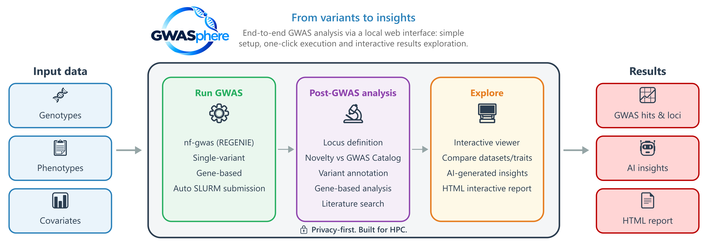

# GWASphere
<p align="center">
  
</p>


**GWASphere** is a unified, fully automated and privacy-first platform for end-to-end GWAS analysis. Easy setup, one-click execution and interactive results exploration.


---

## Overview

GWASphere combines three modules in a single Shiny interface:

| Module | What it does |
|--------|-------------|
| **Run GWAS** | Configure and launch [nf-gwas](https://github.com/genepi/nf-gwas) (REGENIE) via a graphical interface |
| **Post-GWAS analysis** | Automated downstream pipeline: LD clumping & locus definition, GWAS Catalog novelty check, functional variant annotation (SnpEff), gene-based analysis (MAGMA), PubMed literature search, regional association plots |
| **Explore Results** | Interactive viewer with multi-dataset comparison, cross-trait overlap, AI-generated insights, and HTML report export |

---

## Workflow



---

## Prerequisites

- **Conda** (Miniconda or Anaconda)
- **Singularity** (to download the tools image)
- **Java 21+** and **Nextflow** → [install](https://www.nextflow.io/docs/latest/install.html)

---

## One-time setup

### 1. Clone the repository

```bash
git clone https://github.com/euracbiomedicalresearch/gwasphere
cd gwasphere
```

### 2. Create the conda environment

```bash
conda env create -f environment.yml
```

This installs R, Python and all required packages.

### 3. Download reference tools

```bash
singularity pull gwasphere_tools.sif docker://ghcr.io/euracbiomedicalresearch/gwasphere-tools:latest
singularity exec gwasphere_tools.sif cp -r /gwasphere_tools $HOME/
```

Downloads MAGMA, SnpEff, GWAS Catalog and reference files into `$HOME/gwasphere_tools/`.

### Bundled tool versions

Tool and reference database versions are recorded in:
```
$HOME/gwasphere_tools/versions.txt
```

To update any tool or reference file, replace it in `$HOME/gwasphere_tools/`.

**nf-gwas:** v1.0.11 (auto-downloaded by Nextflow at first run from [github.com/genepi/gwas-regenie](https://github.com/genepi/gwas-regenie))

---

### 4. Set up Ollama (optional — AI reports only)

```bash
# Edit setup_ollama.sh with your SLURM partition, then:
sbatch setup_ollama.sh
```

### 5. Configure the launch script

Open `master/run.sh` and edit the following — these are the only settings you **must** change:

```bash
# SLURM settings — always edit these
#SBATCH --partition=YOUR_PARTITION
#SBATCH --nodelist=YOUR_COMPUTE_NODE
#SBATCH --output=/your/path/gwasphere_%j.out
#SBATCH --error=/your/path/gwasphere_%j.err

# Path to the GWASphere repository — always edit this
export GWASPHERE_BASE_DIR="/path/to/gwasphere"

# Java — edit if 'java' is not in your PATH
export NXF_JAVA_HOME="path/to/java/"
# Nextflow — edit if 'nextflow' is not in your PATH
export NEXTFLOW_BIN="path/to/nextflow"

# Edit if you want a different port (default: 3838):
# PORT=4242
```

> All other paths default to `$HOME/gwasphere_tools` — no changes needed if you followed the setup steps above.

> **Port:** If you change `PORT`, update the SSH tunnel command accordingly.

---

## Input data format

### Genotype files

GWASphere / nf-gwas requires two sets of genotype files:

| Parameter | Format | Description |
|-----------|--------|-------------|
| `genotypes_prediction` | PLINK `.bed/.bim/.fam` (single merged file) | Array genotypes — used by REGENIE step 1 to fit the null model |
| `genotypes_association` | VCF (`.vcf.gz`) or BGEN (`.bgen`) per chromosome | Imputed genotypes — used by REGENIE step 2 for association testing |

**Example:**
```
/path/to/array_genotypes.bed
/path/to/array_genotypes.bim
/path/to/aarray_genotypes.fam

/path/to/imputed_chr1.vcf.gz
/path/to/imputed_chr2.vcf.gz
...
/path/to/imputed_chr22.vcf.gz
```

### Phenotype file

Tab- or space-separated, with a header. The first two columns must be `FID` and `IID` (matching the genotype `.fam` file), followed by one column per trait. Missing values should be coded as `NA`.

```
FID    IID    bmi     height  sbp
1001   1001   24.5    172.3   120
1002   1002   NA      165.1   118
1003   1003   27.1    180.0   135
```

### Covariate file

Same format as the phenotype file — `FID`, `IID`, then one column per covariate.

```
FID    IID    age   sex   PC1       PC2       PC3
1001   1001   45    1     0.0023   -0.0011    0.0005
1002   1002   52    2    -0.0014    0.0032   -0.0009
1003   1003   38    1     0.0041    0.0017    0.0012
```

> **Tip:** `FID` and `IID` can be the same value if you do not use family structure. 

---

## Launch

```bash
sbatch master/run.sh
```

Then open an SSH tunnel from your local machine:

```bash
# Find the compute node
squeue -u $USER

# Open tunnel
ssh -L 3838:COMPUTE_NODE:3838 username@login_node
```

Open **http://localhost:3838** in your browser.


## AI Reports

Available on-demand from the **Explore Results** tab after running the downstream pipeline. Requires Ollama (Step 4 above).

The LLM runs entirely on your cluster. Reports summarise loci by strength of evidence (GWAS Catalog support, PubMed hits, MAGMA gene convergence) and are clearly labelled as AI-generated.

---